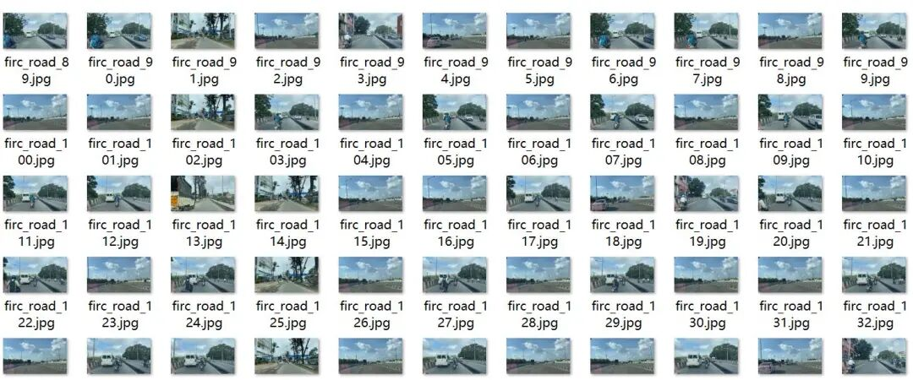
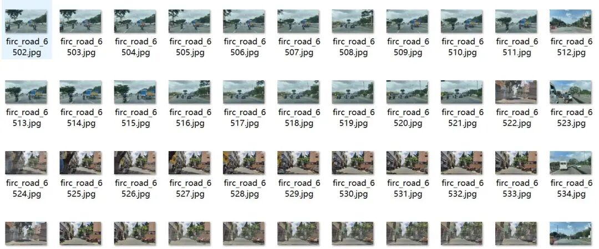
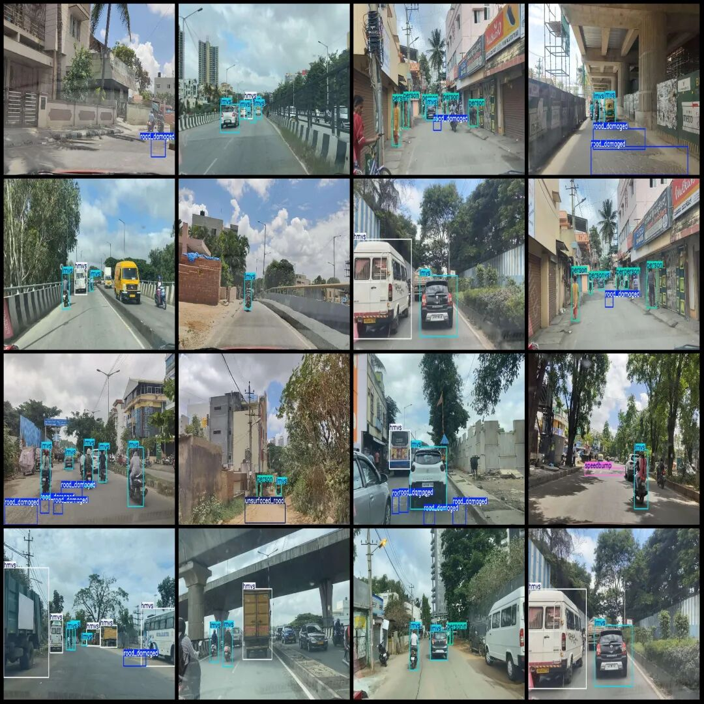

# Intelligent Transportation Autonomous Driving Scenario Road Abnormality Detection Dataset VOC+YOLO Format: 8302 Images, 6 Categories

Dataset format: Pascal VOC format + YOLO format (txt file without split path, only containing jpg images and corresponding VOC format xml files and yolo format txt files)

Number of images (number of jpg files): 8302

Number of annotations (number of xml files): 8302

Number of annotations (number of txt files): 8302

Label count: 6

Label category names (note that the order of yolo format categories does not correspond to this, but is based on the labels folder's classes.txt): ["hmvs", "lmvs", "person", "road_damaged", "speedbump", "unsurfaced_road"]

Number of boxes labeled in each category:

HMVS (Buses, Trucks, Tractors, JCB Excavators, Vans) Frame Count = 4431

lmvs (light motor vehicles, including cars, motorcycles, small trucks, and small vans) frame count = 14390

Person (Pedestrian) Frames = 3563

Road_damaged (road damage (ruts, cracks, bumps, manhole covers)) frame count = 6463

Speed bump (deceleration strip) frame count = 499

Unsurfaced_road (unsurfaced road (unpaved road)) Frames = 593

Total frame count: 29939

Image resolution: 1920x1080

Using labelImg:

Annotation rules: Draw a rectangle around the category.

Important Notice: No

Special : This dataset does not guarantee the accuracy of the trained models or weight files.

Image Preview:

Annotation example:

## Payment

Here is a pay link on Stripe ( https://buy.stripe.com/3cs8yP7sY87d0vu9AB ). Please contact me lonlonago@foxmail.com after funding $89, and I will send you a complete data files , thank you!

